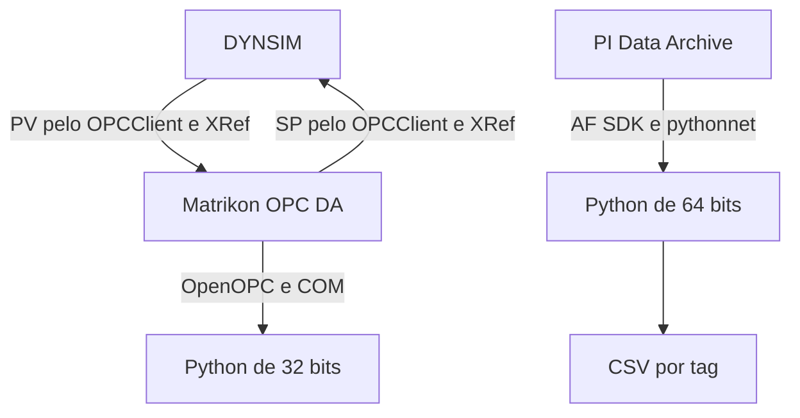

<p align="center">
  
  
  
  
  
</p>

<h1 align="center">🔗 DYNSIM e PI Server → Python<br>Aquisição via OPC DA e AF SDK</h1>

<p align="center">
  <strong>Leitura de variáveis de simulação e extração de eventos históricos de processo</strong><br>
  <em>Configuração, execução e validação dos dados em ambientes Python separados.</em>
</p>

<p align="center">
  <a href="#visao-geral">🎯 Visão geral</a> •
  <a href="#arquitetura">🏗️ Arquitetura</a> •
  <a href="#inicio-rapido">🚀 Início rápido</a> •
  <a href="#documentacao">📖 Documentação</a> •
  <a href="#diagnostico">🔧 Diagnóstico</a>
</p>

---

<a name="visao-geral"></a>

## 🎯 Visão geral

O projeto reúne duas rotas de aquisição de dados com Python:

- **DYNSIM e Matrikon OPC DA:** consulta dos valores atuais de uma simulação em execução.
- **PI Data Archive e AF SDK:** extração dos eventos históricos de tags em um intervalo definido.

Os procedimentos abrangem a criação dos aliases OPC, a configuração do motor de comunicação, o vínculo das variáveis pelo XRef e a preparação dos ambientes Python. Para PI, o notebook executa a consulta e exporta um arquivo CSV por tag.

### Recursos disponíveis

- ✅ **Leitura OPC pontual ou contínua**, com apresentação de valor, qualidade e horário do servidor.
- ✅ **Extração histórica por tag**, com seleção de servidor e período.
- ✅ **Ambientes Python separados**, de 32 bits para o caso OPC e de 64 bits para PI.
- ✅ **Exportação CSV no notebook PI**, com preservação de estados textuais.
- ✅ **Guia integrado em português**, com parâmetros, capturas e critérios de validação.

---

<a name="arquitetura"></a>

## 🏗️ Arquitetura



### Aquisição do DYNSIM

O caso de referência utiliza o motor de processo `Dynsim` e o motor de comunicação `OPC01`, do tipo `OPCClient`. O arquivo `OPC01.ocf` define a conexão com Matrikon e os itens de comunicação. O XRef estabelece o sentido da transferência:

| Variável | Origem | Destino | Lista no OPC Configurator |
|---|---|---|---|
| `FC101.PV` | Motor `Dynsim` | Servidor Matrikon por `OPC01` | `Model Inputs` |
| `FC101.SP` | Servidor Matrikon por `OPC01` | Motor `Dynsim` | `Model Outputs` |

O programa Python consulta ambos os tags por OpenOPC. A escrita do SP é realizada por Explorer no procedimento documentado; o leitor Python fornecido não escreve nos tags.

### Aquisição do PI Server

O notebook carrega `OSIsoft.AFSDK.dll` por `pythonnet`, localiza os pontos solicitados e consulta os eventos com `RecordedValues`. Os resultados são organizados em um DataFrame e exportados por tag.

As duas rotas são independentes. A criação de um alias em Matrikon não cadastra um PI Point nem configura sua gravação histórica. A rota PI pressupõe pontos existentes e historizados no Data Archive.

---

<a name="inicio-rapido"></a>

## 🚀 Início rápido

### Requisitos

| Componente | Configuração utilizada | Finalidade |
|---|---|---|
| Windows | Estação de execução dos clientes | Integração COM e AF SDK |
| AVEVA Dynamic Simulation | Versão 2023 no caso documentado | Simulação DYNSIM |
| MatrikonOPC Server for Simulation | `Matrikon.OPC.Simulation.1` | Servidor OPC DA |
| Matrikon OPC Explorer | Cliente de conferência | Validação e escrita inicial do SP |
| Python OPC | 3.12 de 32 bits | Execução do leitor OpenOPC |
| Python PI | 3.12 de 64 bits | Execução do notebook |
| PI AF Client | AF SDK instalado | Acesso ao Data Archive |
| Jupyter ou VS Code | Kernel Python do ambiente PI | Execução das células |

As instalações do simulador, de Matrikon e do cliente PI devem estar disponíveis na estação. Para PI, também são necessários acesso à rede interna ou VPN e permissões de leitura no servidor.

### 1 Preparação dos arquivos

Obtêm-se os arquivos pelo botão **Code → Download ZIP** do repositório e extrai-se o conteúdo em uma pasta de trabalho. Os comandos seguintes são executados no PowerShell aberto nessa pasta.

A configuração do caso DYNSIM e a validação dos tags em Explorer são executadas conforme as seções 3 a 7 do [guia integrado](docs/Guia_Aquisicao_DYNSIM_PI_Python_PT.pdf).

### 2 Leitura do DYNSIM por OPC DA

```powershell
# Preparação do ambiente de 32 bits
py -3.12-32 -m venv .venv_opc
.\.venv_opc\Scripts\python.exe -m pip install -r requirements-opc.txt

# Leitura pontual
.\.venv_opc\Scripts\python.exe leer_matrikon_opc_da.py --once
```

Para a leitura contínua:

```powershell
.\.venv_opc\Scripts\python.exe leer_matrikon_opc_da.py --interval 1
```

O parâmetro `--once` encerra a execução após uma consulta. O modo contínuo permanece ativo até Ctrl+C ou uma exceção. `--interval 1` define uma espera de um segundo entre consultas, acrescida do tempo de comunicação.

O cliente utiliza `Matrikon.OPC.Simulation.1` em `localhost` e os seguintes Item ID:

```text
Process.Plant01.Control.FC101.PV
Process.Plant01.Control.FC101.SP
```

O horário OPC corresponde à marca de tempo fornecida pelo servidor; ele não representa o tempo interno da simulação DYNSIM.

### 3 Extração do PI Server

```powershell
# Preparação do ambiente de 64 bits
py -3.12-64 -m venv .venv_pi
.\.venv_pi\Scripts\python.exe -m pip install -r requirements-pi.txt

# Registro do kernel
.\.venv_pi\Scripts\python.exe -m ipykernel install --user --name pi_afsdk `
    --display-name "PI AF SDK 64 bits"

# Inicialização da interface
.\.venv_pi\Scripts\python.exe -m jupyter notebook
```

Abre-se `Extrator_Dados_PI.ipynb` e seleciona-se **PI AF SDK 64 bits**. No VS Code, pode-se selecionar diretamente o ambiente `.venv_pi`.

Antes da execução, conferem-se os parâmetros:

| Parâmetro | Configuração |
|---|---|
| `caminho_sdk` | Diretório que contém `OSIsoft.AFSDK.dll` |
| `meu_servidor` | Data Archive configurado no cliente PI |
| `data_inicio` | Início do período de extração |
| `data_fim` | Fim do período de extração; `*` indica o instante atual |
| `tags_para_buscar` | Lista dos nomes exatos dos PI Points |

As três células de código são executadas na ordem apresentada: carga do SDK, definição da função de extração e processamento das tags. Datas finais absolutas permitem utilizar o mesmo limite temporal para todas as variáveis.

---

## 📂 Arquivos do projeto

| Arquivo | Descrição |
|---|---|
| [`leer_matrikon_opc_da.py`](leer_matrikon_opc_da.py) | Cliente de leitura dos valores atuais de Matrikon |
| [`Extrator_Dados_PI.ipynb`](Extrator_Dados_PI.ipynb) | Notebook de extração histórica pelo AF SDK |
| [`requirements-opc.txt`](requirements-opc.txt) | Dependências do ambiente OPC |
| [`requirements-pi.txt`](requirements-pi.txt) | Dependências do ambiente PI |
| [`docs/`](docs/) | Guia técnico em PDF e Word |

---

## 📊 Resultados e formato dos dados

### Saída OPC DA

O leitor apresenta `Item ID`, valor, qualidade e horário OPC na console. A leitura pontual confirmada no caso FC101 apresentou:

| Tag | Valor observado | Qualidade |
|---|---:|---|
| `Process.Plant01.Control.FC101.PV` | 82.402079 | Good |
| `Process.Plant01.Control.FC101.SP` | 85.000000 | Good |

Os valores dependem do estado do caso. A chegada de dados do simulador é verificada pela comparação da PV entre FC101, Explorer e Python durante uma variação do processo. O leitor fornecido não exporta CSV.

### Saída PI

Para cada tag, o notebook produz um arquivo com as colunas `Tag`, `Timestamp` e `Value`. O separador é ponto e vírgula, e os valores numéricos são formatados com vírgula decimal. Estados como `Pt Created` permanecem como texto.

Os arquivos são gravados no **diretório de trabalho do kernel**, identificado por `Path.cwd()`. Uma nova extração da mesma tag sobrescreve o arquivo de mesmo nome.

A execução armazenada no notebook original registrou **773 eventos de FC101.PV** e **94 eventos de LC101.PV**, em um lote por tag. A cópia preparada para o repositório preserva o código e remove as saídas anteriores das células.

---

<a name="documentacao"></a>

## 📖 Documentação

O **guia integrado de 14 páginas**, em português, apresenta:

- Criação dos grupos e aliases no servidor Matrikon.
- Validação dos Item ID e da qualidade em OPC Explorer.
- Geração do arquivo OCF e configuração do motor OPCClient.
- Relações PV/SP no XRef e execução da simulação.
- Preparação dos ambientes Python de 32 e 64 bits.
- Configuração e execução do notebook PI.
- Interpretação dos horários, do CSV e dos estados textuais.
- Diagnóstico de erros e limites da evidência de validação.

📄 **[Consultar o guia em PDF](docs/Guia_Aquisicao_DYNSIM_PI_Python_PT.pdf)**  
📝 **[Consultar a versão editável em Word](docs/Guia_Aquisicao_DYNSIM_PI_Python_PT.docx)**

---

<a name="diagnostico"></a>

## 🔧 Diagnóstico

<details>
<summary><strong>Dispatch Classe não registrada na conexão OPC</strong></summary>

Confere-se a execução pelo ambiente `.venv_opc` de 32 bits. O componente OPC Automation deve estar instalado e registrado no Windows. No caso documentado, a conexão funcionou com Python 3.12.10 de 32 bits após a falha do ambiente de 64 bits.

</details>

<details>
<summary><strong>O programa OPC termina após uma leitura</strong></summary>

Confere-se a presença de `--once`. Para consultas contínuas, utiliza-se `--interval 1` sem essa opção. Se a execução continuar terminando, registra-se a exceção apresentada na console.

</details>

<details>
<summary><strong>A PV não acompanha a simulação</strong></summary>

Conferem-se o estado `RUNNING`, o avanço do tempo, a relação `Dynsim / FC101.PV → OPC01 / Item ID da PV`, a lista `Model Inputs` e a aplicação de `Load XRef`. `Disabled` deve permanecer desmarcado na relação utilizada.

</details>

<details>
<summary><strong>OSIsoft.AFSDK.dll não carrega no notebook</strong></summary>

Conferem-se a instalação do AF SDK, `caminho_sdk` e o ambiente selecionado. As dependências instaladas por pip não instalam a biblioteca proprietária. Após corrigir um erro de carga ou importação, reinicia-se o kernel e executam-se novamente as células na ordem documentada.

</details>

<details>
<summary><strong>O servidor PI não é encontrado ou o acesso é negado</strong></summary>

Conferem-se o servidor padrão ou sua seleção explícita, a rede interna ou VPN e as permissões de leitura do usuário Windows. A resposta a ping, isoladamente, não comprova o acesso ao Data Archive pelo AF SDK.

</details>

<details>
<summary><strong>O CSV não aparece na pasta esperada</strong></summary>

Executa-se `Path.cwd()` no kernel para identificar o diretório de saída. Conferem-se também o período solicitado e as mensagens de cada tag. Uma consulta sem eventos pode produzir apenas o cabeçalho; a mensagem final de sucesso não substitui a conferência das extrações individuais.

</details>

---

## 🔬 Abrangência da validação

A evidência disponível confirma a leitura OPC pontual e as duas extrações PI mencionadas. A execução OPC contínua e a paginação PI acima de 50000 registros não foram confirmadas por esses resultados.

O notebook avança o início da consulta em 1 ms após o último evento de um lote completo. Esse avanço pode excluir eventos na fronteira. O valor `LOTE_MAXIMO = 50000` pertence ao código e não estabelece o valor de `ArcMaxCollect` do servidor.

O CSV PI apresenta horário local formatado em segundos, sem fuso explícito, frações de segundo ou indicadores de qualidade do AF SDK. Essas propriedades são consideradas ao sincronizar sinais e preparar dados para identificação de sistemas.

Os nomes exatos dos dois diálogos de seleção do servidor e inclusão de itens no OPC Configurator permanecem pendentes de confirmação, conforme a seção 5 do guia.

---

## 👤 Autoria

**Ezequiel José Valencia Urbina**  
Integração DYNSIM e documentação do caso FC101.

- 🎓 Mestrando em Engenharia Mecânica na Universidade de Brasília, na área de Dinâmica de Sistemas.
- 🔬 Pesquisa em controle de processos, identificação de sistemas, sensores virtuais e gêmeos digitais.
- 📧 [urbina.ezequiel@aluno.unb.br](mailto:urbina.ezequiel@aluno.unb.br)

**José Matheus Mendes Trindade**  
Desenvolvimento do notebook e do tutorial original de extração PI, no Projeto Refino da Universidade de Brasília.

---

<p align="center">
  <strong>Universidade de Brasília · Aquisição de dados de processo</strong><br>
  <em>Integração entre simulação, histórico industrial e análise em Python.</em>
</p>
